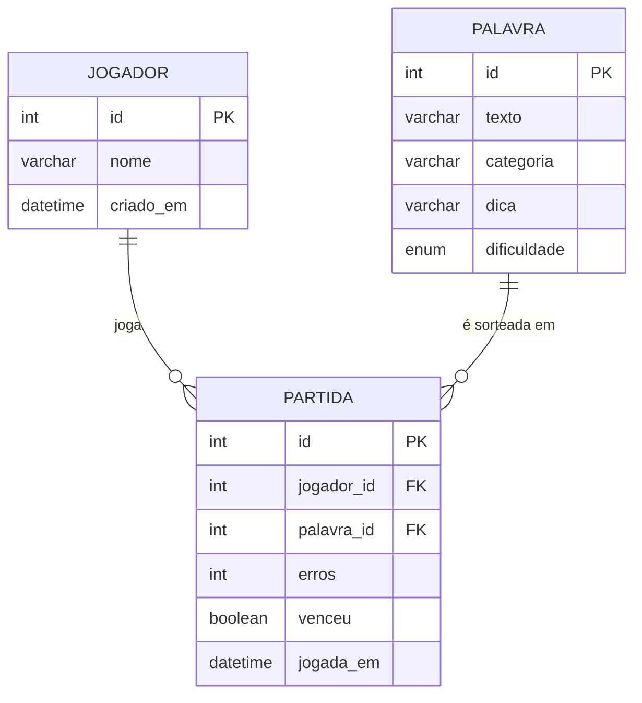

<div align="center">


<br><br>

<h1>🪢 Jogo da Forca</h1>

<p><b>Adivinhe a palavra antes que o boneco perca a última perna.</b><br>
Um clássico feito em <b>Java</b>, com palavras, jogadores e partidas guardados em <b>SQL</b>.</p>

<p>
  
  
  
  
</p>

<p>
  <a href="#-como-jogar">Como jogar</a> &nbsp;•&nbsp;
  <a href="#-funcionalidades">Funcionalidades</a> &nbsp;•&nbsp;
  <a href="#-banco-de-dados">Banco de dados</a> &nbsp;•&nbsp;
  <a href="#-instalação">Instalação</a> &nbsp;•&nbsp;
  <a href="#-estrutura-do-projeto">Estrutura</a> &nbsp;•&nbsp;
  <a href="#-roadmap">Roadmap</a>
</p>

</div>

<br>

## 🎯 Sobre o projeto

O **Jogo da Forca** sorteia uma palavra guardada no banco de dados, mostra os espaços em branco e deixa você chutar uma letra por vez. Cada erro desenha uma parte do boneco. Seis erros e o jogo acaba.

O projeto nasceu para praticar três coisas ao mesmo tempo: **orientação a objetos em Java**, **modelagem de banco relacional** e **integração via JDBC**. Cada partida fica registrada, então dá para montar ranking e histórico de cada jogador.

<br>

## 🕹️ Como jogar

```text
  +---+
  |   |
  O   |        Palavra:  J A _ A
 /|\  |        Erros:    X  Q  Z   (3/6)
      |
      |        Dica: linguagem de programação
=========

Digite uma letra: v
```

1. Informe seu nome para entrar (ou criar) seu perfil de jogador.
2. Escolha a **categoria** e a **dificuldade** da palavra.
3. Digite uma letra por vez. Acertou, ela aparece na palavra. Errou, o boneco ganha uma parte.
4. Complete a palavra antes do 6º erro para vencer.
5. Ao final, a partida é salva e o seu ranking é atualizado.

<br>

## ✨ Funcionalidades

<table>
  <tr>
    <td width="33%" valign="top">
      <h3>🎲 Palavras no banco</h3>
      Sorteio de palavras por categoria e dificuldade, direto de uma tabela SQL.
    </td>
    <td width="33%" valign="top">
      <h3>👤 Jogadores</h3>
      Cadastro automático no primeiro acesso e perfil reaproveitado nas próximas partidas.
    </td>
    <td width="33%" valign="top">
      <h3>🏆 Ranking</h3>
      Classificação por vitórias e aproveitamento, calculada com uma <code>VIEW</code>.
    </td>
  </tr>
  <tr>
    <td valign="top">
      <h3>📜 Histórico</h3>
      Todas as partidas ficam registradas com palavra, erros, resultado e data.
    </td>
    <td valign="top">
      <h3>🧩 Dicas</h3>
      Cada palavra tem uma dica opcional ligada à sua categoria.
    </td>
    <td valign="top">
      <h3>🔒 Consultas seguras</h3>
      Acesso ao banco com <code>PreparedStatement</code>, sem concatenar SQL.
    </td>
  </tr>
</table>

<br>

## 🛠️ Tecnologias

| Camada | Tecnologia | Para quê |
| :-- | :-- | :-- |
| Linguagem | **Java 17+** | Regras do jogo e interface de terminal |
| Banco de dados | **MySQL 8** (ou outro SQL compatível) | Palavras, jogadores e partidas |
| Acesso a dados | **JDBC** + padrão **DAO** | Separar o SQL das regras do jogo |
| Build | **Maven** | Dependências e execução |

<br>

## 🗄️ Banco de dados

O modelo tem três tabelas ligadas por chaves estrangeiras.



<details>
<summary><b>📄 Ver o script de criação das tabelas (<code>sql/schema.sql</code>)</b></summary>

```sql
CREATE DATABASE IF NOT EXISTS forca
  CHARACTER SET utf8mb4 COLLATE utf8mb4_unicode_ci;
USE forca;

CREATE TABLE jogador (
  id         INT AUTO_INCREMENT PRIMARY KEY,
  nome       VARCHAR(50) NOT NULL UNIQUE,
  criado_em  DATETIME DEFAULT CURRENT_TIMESTAMP
);

CREATE TABLE palavra (
  id            INT AUTO_INCREMENT PRIMARY KEY,
  texto         VARCHAR(40) NOT NULL,
  categoria     VARCHAR(30) NOT NULL,
  dica          VARCHAR(120),
  dificuldade   ENUM('FACIL', 'MEDIO', 'DIFICIL') NOT NULL DEFAULT 'MEDIO'
);

CREATE TABLE partida (
  id           INT AUTO_INCREMENT PRIMARY KEY,
  jogador_id   INT NOT NULL,
  palavra_id   INT NOT NULL,
  erros        TINYINT NOT NULL DEFAULT 0,
  venceu       BOOLEAN NOT NULL,
  jogada_em    DATETIME DEFAULT CURRENT_TIMESTAMP,
  FOREIGN KEY (jogador_id) REFERENCES jogador(id),
  FOREIGN KEY (palavra_id) REFERENCES palavra(id)
);

-- Ranking de jogadores
CREATE VIEW ranking AS
SELECT j.nome,
       COUNT(*)                                  AS partidas,
       SUM(p.venceu)                             AS vitorias,
       ROUND(100 * SUM(p.venceu) / COUNT(*), 1)  AS aproveitamento
FROM partida p
JOIN jogador j ON j.id = p.jogador_id
GROUP BY j.id
ORDER BY vitorias DESC, aproveitamento DESC;
```

</details>

<details>
<summary><b>🌱 Ver os dados iniciais (<code>sql/seed.sql</code>)</b></summary>

```sql
INSERT INTO palavra (texto, categoria, dica, dificuldade) VALUES
('JAVA',        'Programação', 'Linguagem que roda na JVM',        'FACIL'),
('BANCO',       'Programação', 'Onde os dados ficam guardados',    'FACIL'),
('CONSULTA',    'Programação', 'Um SELECT é um exemplo',           'MEDIO'),
('POLIMORFISMO','Programação', 'Um dos pilares da POO',            'DIFICIL'),
('ABACAXI',     'Frutas',      'Tem coroa e é azedinha',           'MEDIO'),
('ELEFANTE',    'Animais',     'Tem tromba e orelhas enormes',     'MEDIO');
```

</details>

<br>

## 🚀 Instalação

### Pré-requisitos

- ☕ **JDK 17** ou superior
- 🐬 **MySQL 8** em execução
- 📦 **Maven 3.8+**

### Passo a passo

**1. Clone o repositório**

```bash
git clone https://github.com/SEU-USUARIO/forca-java-sql.git
cd forca-java-sql
```

**2. Crie o banco e carregue as palavras**

```bash
mysql -u root -p < sql/schema.sql
mysql -u root -p < sql/seed.sql
```

**3. Configure a conexão** em `src/main/java/com/forca/db/ConexaoBD.java`

```java
private static final String URL     = "jdbc:mysql://localhost:3306/forca";
private static final String USUARIO = "root";
private static final String SENHA   = "sua_senha";
```

> 💡 **Dica:** para não deixar a senha no código, leia os valores de variáveis de ambiente com `System.getenv("FORCA_DB_SENHA")`.

**4. Compile e execute**

```bash
mvn compile exec:java -Dexec.mainClass="com.forca.Main"
```

<br>

## 🗂️ Estrutura do projeto

```text
forca-java-sql/
├── assets/
│   └── banner.svg
├── sql/
│   ├── schema.sql          # tabelas e view de ranking
│   └── seed.sql            # palavras iniciais
├── src/main/java/com/forca/
│   ├── Main.java           # ponto de entrada e menu
│   ├── db/
│   │   └── ConexaoBD.java  # conexão JDBC
│   ├── model/
│   │   ├── Palavra.java
│   │   ├── Jogador.java
│   │   └── Partida.java
│   ├── dao/
│   │   ├── PalavraDAO.java
│   │   ├── JogadorDAO.java
│   │   └── PartidaDAO.java
│   └── service/
│       └── JogoService.java  # regras da forca
├── pom.xml
└── README.md
```

<br>

## 📊 Consultas úteis

Palavra sorteada por categoria e dificuldade:

```sql
SELECT texto, dica
FROM palavra
WHERE categoria = ? AND dificuldade = ?
ORDER BY RAND()
LIMIT 1;
```

Top 5 do ranking:

```sql
SELECT * FROM ranking LIMIT 5;
```

<br>

## 🗺️ Roadmap

- [x] Sorteio de palavras pelo banco de dados
- [x] Cadastro de jogadores
- [x] Registro de partidas
- [x] Ranking com `VIEW`
- [ ] Cadastro de novas palavras pelo menu do jogo
- [ ] Modo para dois jogadores
- [ ] Interface gráfica com JavaFX
- [ ] Testes unitários com JUnit

<br>

## 🤝 Contribuindo

Contribuições são bem-vindas. Para sugerir uma melhoria:

1. Faça um **fork** do projeto
2. Crie uma branch: `git checkout -b feature/minha-ideia`
3. Faça o commit: `git commit -m "Adiciona minha ideia"`
4. Envie para o seu fork: `git push origin feature/minha-ideia`
5. Abra um **Pull Request**

<br>

## 📄 Licença

Distribuído sob a licença **MIT**. Veja o arquivo [`LICENSE`](LICENSE) para mais detalhes.

<br>

<div align="center">


<p>Feito por: </p>
<p><a href="https://github.com/arydevv"><b>Arydevv</a></p>
<p><a href="https://github.com/GabrielFranthesco"><b>GabrieFranthesco/b></a></p>
<p><a href="https://github.com/Ramoncpu"><b>Ramoncpu/b></a></p>

<sub>Se o projeto te ajudou, deixe uma ⭐ para o boneco não ser enforcado à toa.</sub>

</div>
